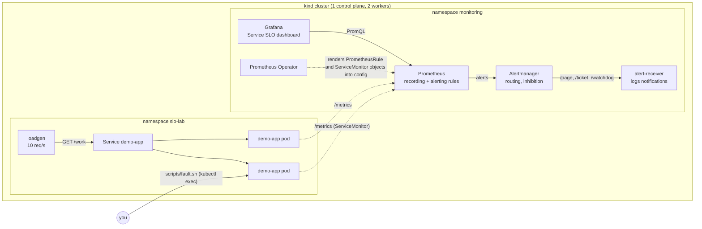
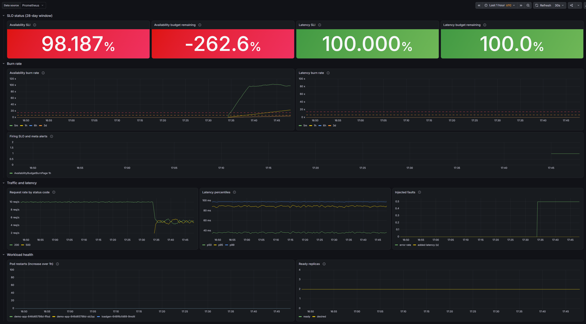
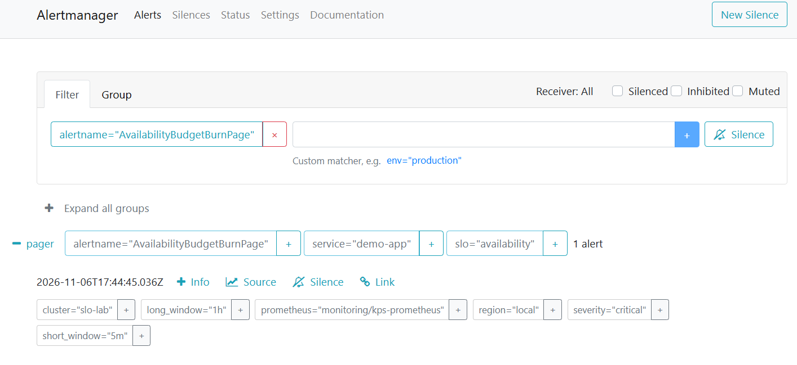
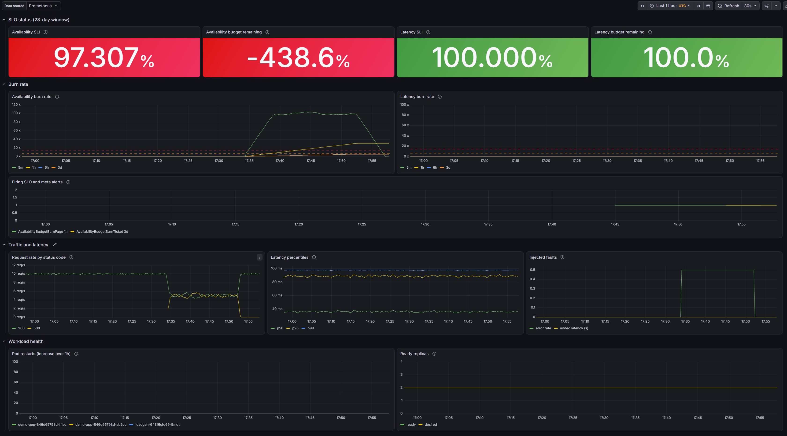

# slo-lab

A small Kubernetes observability setup that monitors a demo service against
two SLOs. It runs entirely on a local kind cluster and includes:

- a Python service with Prometheus metrics and a runtime fault-injection endpoint
- kube-prometheus-stack (Prometheus, Alertmanager, Grafana) installed with Helm
- SLI recording rules and multiwindow, multi-burn-rate alerts, with promtool unit tests
- a Grafana SLO dashboard kept as JSON and provisioned automatically
- Alertmanager routing by severity to an in-cluster webhook receiver, with inhibition
- alerts about the monitoring system itself (Watchdog, target down, rule failures, notification failures)
- a scripted incident drill, a postmortem written from a real run, and a runbook per alert
- CI that lints, validates and tests everything that does not need a cluster

The SLO definitions and the reasoning behind the alert thresholds are in
[docs/slo.md](docs/slo.md).

## Architecture



Request path to notification:

1. The load generator calls `GET /work`. The app counts the request in
   `http_requests_total{route,method,code}` and observes its duration in the
   `http_request_duration_seconds` histogram.
2. Prometheus scrapes both pods every 15 seconds, as configured by the
   ServiceMonitor.
3. Recording rules turn the raw counters into error ratios per window
   (`slo:sli_error:ratio_rate5m` ... `ratio_rate28d`).
4. Alerting rules compare those ratios with burn-rate thresholds and send
   firing alerts to Alertmanager.
5. Alertmanager groups them, applies inhibition (a page hides the matching
   ticket), and posts them to the receiver on `/page` or `/ticket`.

## Prerequisites

| Tool | Version used | Notes |
|------|--------------|-------|
| Docker | Docker Desktop with engine 29.9 | WSL2 backend on Windows |
| kind | v0.33.0 | node image `kindest/node:v1.36.4` (pinned by digest in `kind/cluster.yaml`) |
| kubectl | v1.36.6 | |
| Helm | v3.22.1 | chart `kube-prometheus-stack` 92.21.1, pinned in `scripts/lib.sh` |
| Python | 3.11 or newer | used by the scripts for JSON parsing, and for the app tests |
| promtool, amtool | 3.16.0, 0.34.2 | only for `make check` |
| make | any | optional, see below |

The cluster uses about 4 GB of memory once everything is running, Thanos
included (measured with `docker stats` across the three node containers).

### Running on Windows

All scripts are bash and work from **Git Bash** or a **WSL2** shell.

- Git Bash: install the Windows builds of kind, kubectl and helm and put
  them on `PATH`. The scripts detect Git Bash and convert paths for the
  Windows executables. Git for Windows does not include `make`, so either
  run the scripts directly (`bash scripts/up.sh`) or install make
  (`winget install ezwinports.make`).
- WSL2: install the Linux builds inside the distribution and enable Docker
  Desktop's WSL integration for it (Settings > Resources > WSL integration).
  `make` works as on Linux.

Each `make` target is a one-line call to a script under `scripts/`, so the
two forms are interchangeable: `make up` is `bash scripts/up.sh`.

## Quickstart

```bash
make up        # create cluster, install monitoring, deploy app, run smoke test
make ports     # port-forward the UIs (leave running)
```

On the machine this was built on (22 CPUs, 20 GB for Docker), a full
`scripts/up.sh` from no cluster to a passing smoke test took 4 minutes 53
seconds, with the kind node and Python base images already in the local
Docker cache. The monitoring stack's images were pulled fresh. A first run
also has to download those two images, so it takes longer. `make thanos`
added 86 seconds.

Then open:

- Grafana: http://localhost:3000, user `admin`, password printed by
  `make ports`. Dashboard: "Service SLO: demo-app".
- Prometheus: http://localhost:9090 (Alerts page, Status > Target health)
- Alertmanager: http://localhost:9093

What the receiver got:

```bash
kubectl logs -n monitoring deployment/alert-receiver -f
```

Tear down with `make down`.

### Screenshots

Taken on 2026-11-06 during a manual run: 50% errors injected at 17:33:50
UTC, `AvailabilityBudgetBurnPage` (1h/5m) firing from 17:44:45 UTC, fault
cleared at 17:52:06 UTC, page resolved by 17:57:34 UTC.

The Service SLO dashboard while the page was firing. The 5m burn rate is
near 100x, well above the dashed 14.4x line, and the firing-alerts panel
shows the page:



The page in Alertmanager, routed to the `pager` receiver with
`severity="critical"`. The ticket for the same SLO was also firing in
Prometheus but is hidden here, because the page inhibits it:



The same dashboard after the fault was cleared. The 5m burn rate is back
to zero and the page has resolved. The 3d ticket (yellow) is still firing,
because its long window still contains the incident:



## Incident drill

Inject faults by hand:

```bash
make fault-errors RATE=0.5    # 50% of /work requests return 500
make fault-latency MS=400     # every /work request takes 400 ms longer
make fault-show
make fault-clear
```

Each command replaces the previous setting in every running pod. Then watch
the "Service SLO" dashboard and the Prometheus Alerts page.

Or run the scripted drill, which records a timeline:

```bash
make drill                      # both phases, over an hour
PHASES=errors bash scripts/drill.sh
```

It injects errors, logs every alert state change with a UTC timestamp,
clears the fault two minutes after the first page fires (a stand-in for a
responder), waits for the pages to resolve, then repeats for latency. Output
goes to `drill-output/<time>/`: `timeline.log` and the notifications the
receiver got. The postmortem of the first real run is in
[docs/postmortems/](docs/postmortems/).

Run the drill only after the cluster has been up for at least 6 hours. On
a younger cluster the long alert windows contain less history than their
names suggest, so the 6h/30m page can fire before the 1h/5m page. The first
drill, run after one hour, did exactly that. See
[docs/slo.md](docs/slo.md#detection-time) and the postmortem.

## Optional: Thanos

```bash
make thanos    # after make up; restarts Prometheus once to add the sidecar
kubectl -n monitoring port-forward svc/thanos-query 10902:10902
```

This adds:

- a Thanos sidecar in the Prometheus pod, which uploads each completed 2-hour
  TSDB block to object storage
- SeaweedFS as S3-compatible object storage (`monitoring/thanos/object-store.yaml`)
- a Thanos store gateway that serves those blocks
- Thanos Query, a PromQL endpoint over both, added to Grafana as the
  "Thanos" datasource

Prometheus gets the external labels `cluster="slo-lab"` and
`region="local"`.

This is a single-cluster approximation of a multi-region setup. In a real
one, each region would run its own Prometheus and sidecar with its own
external labels, all uploading to shared object storage, and one Thanos
Query would fan out to every sidecar and store gateway. Here there is one
Prometheus, the "object storage" is a pod in the same cluster, and nothing
is replicated, so it shows the moving parts and the data flow, not
durability or scale.

MinIO is the usual choice in tutorials, but its container images are no
longer published. SeaweedFS fills the same role through the same S3 API.
Credentials for it are generated at deploy time into Secrets.

## Platform SLO and capacity dashboard

A second dashboard, "Platform: scrape SLO and capacity", shows:

- the monitoring platform's own SLO, scrape success (99.9% of scrape attempts
  succeed), and why its SLI differs from demo-app's (docs/slo.md)
- CPU and memory requests versus actual usage per namespace

## Checks and CI

```bash
make check     # yamllint, shellcheck, kubeconform, promtool, amtool, pytest
make test      # app unit tests only (pip install -r app/requirements-dev.txt first)
```

`.github/workflows/ci.yml` runs the same checks on every push and pull
request, plus a Docker build of the app. A separate `kind-e2e` job runs
`scripts/up.sh` on a fresh kind cluster in the runner, including the smoke
test. It is skipped on pull requests because it takes several minutes.

## Repository layout

```
app/                 demo service (FastAPI), its tests and Dockerfile
k8s/                 manifests for the app, load generator and alert receiver (Kustomize)
kind/cluster.yaml    kind cluster definition
monitoring/          kube-prometheus-stack values and Alertmanager config
monitoring/thanos/   optional Thanos store gateway, query and object storage
rules/               Prometheus recording and alerting rules
rules/tests/         promtool unit tests for the rules
dashboards/          Grafana dashboards as JSON
scripts/             everything the Makefile calls
docs/slo.md          SLO definitions and burn-rate math
docs/runbooks/       one runbook per alert
docs/postmortems/    postmortem template and drill postmortems
.github/workflows/   CI
```

Rules are kept as plain Prometheus rule files so that promtool can check and
unit-test exactly what is deployed. `scripts/render-rules.sh` wraps them in
`PrometheusRule` objects at deploy time.

## Troubleshooting

- **kubelet fails with "configured to not run on a host using cgroup v1".**
  Docker Desktop's WSL2 VM can run cgroup v1, which Kubernetes 1.35+ rejects
  by default. `kind/cluster.yaml` sets `failCgroupV1: false` to allow it. The
  cleaner fix is to switch WSL to cgroup v2 by adding
  `kernelCommandLine = cgroup_no_v1=all` under `[wsl2]` in
  `%UserProfile%\.wslconfig` and running `wsl --shutdown`.
- **`kind load docker-image` fails with "content digest ... not found".**
  This happens with Docker's containerd image store and multi-platform
  images. `scripts/deploy-app.sh` avoids it by exporting only the local
  platform with `docker save --platform`.
- **Control-plane targets (etcd, scheduler, controller-manager, kube-proxy)
  show as down.** The cluster was not created from `kind/cluster.yaml`, which
  binds their metrics endpoints to 0.0.0.0. Recreate it with
  `make down && make up`.

## Limitations

This is a learning and demonstration setup, not a production design.

- One local cluster on one machine. There is no high availability: one
  Prometheus replica, one Alertmanager replica, and the "nodes" are
  containers on the same host.
- Prometheus data lives on a kind local-path volume and is lost with
  `make down`. The 28-day SLO window only covers however long the cluster
  has existed.
- The Watchdog receiver is inside the cluster it watches. A real
  dead-man's switch has to run elsewhere.
- Notifications go to a logging webhook, not to a pager or ticket system.
- The SLIs are measured on the server, so they miss requests that never
  reach the app (see docs/slo.md, "Known gaps").
- Traffic is synthetic and uniform. Real traffic has daily cycles that make
  low-traffic hours noisy for ratio-based alerts.
- Fault state is in process memory and per pod; a restarted pod comes back
  healthy.
- No authentication on the forwarded UIs, no TLS, no network policies, and
  the admin token is a plain Kubernetes Secret.
- Not tested on a cloud provider or at any real scale.
